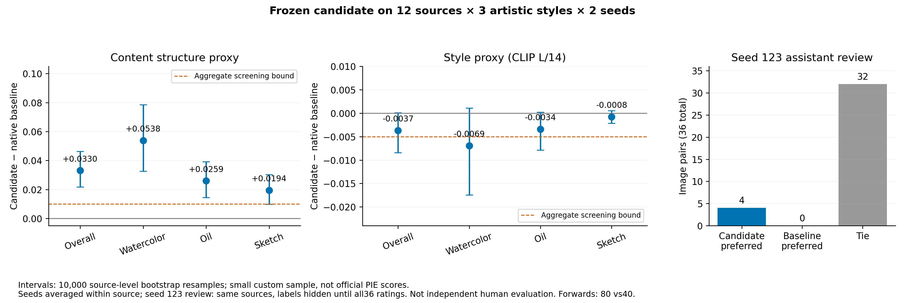
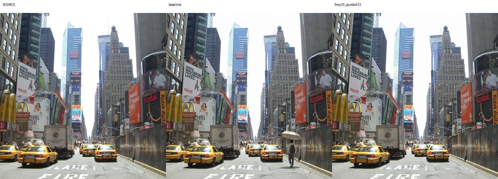

# Qwen-Image Intervention Study

**An exploratory study of model interventions, content preservation, and failure analysis in Qwen-Image-2.1.**

探索Qwen-Image-2.1艺术编辑中的内容保持、内部干预与失败分析。项目记录局部权重、注意力及采样函数干预的探索，关注实验可复核性和副作用。

已完成多轮干预探索和两阶段验证，涵盖162对、324张正式比较输出。仓库提供可直接复核的逐项指标、实验协议和研究记录。

## 阶段发现

- 频率约束候选在12来源、三风格、两种子上的平均DINO内容差值为+0.03302。
- 冻结候选在30新来源、三风格、单种子上的差值为+0.03474，来源级bootstrap区间[0.02540, 0.04522]。
- 30来源CLIP L/14与B/32风格差值为−0.00190和−0.00262，候选约80次模型前向，原模型约40次。
- 注意力头权重修改、输出层权重蒸馏及仅早期启用补丁尚未获得可靠提升。

DINO和CLIP为代理指标。30新来源90对结果的完整视觉审查仍待完成，已有视觉检查由助手实施。实验使用自定义艺术提示词，未复现完整独立Astra系统。当前有效候选主要为采样阶段干预。

## 模型失效发现与纠错分析

在给定原图的编辑任务中，记录了以下现象，并对预选案例进行了干预比较。

- **对象新增**：在要求保持原图内容的恒等编辑测试中，出现输出新增行人／伞、货车的案例，明确的保持内容指令仍不能保证逐对象一致。
- **局部位置偏移**：艺术风格转换中，人物头部和眼睛、碗及果实等局部位置出现变化。助手配对审查在部分样本上观察到候选输出的布局更接近原图。
- **选择性修复**：频率约束修复了预选行人／伞新增案例，单独调整CFG未能修复该例；同一频率方法对预选货车新增案例仍未奏效。
- **内容与风格的权衡**：部分较强约束提高内容相似度，同时压制艺术转换。实验采用内容和风格联合评价，并保留失败结果。

这些发现来自具体案例及配对评估，对象新增案例数量不足以估计总体错误率。早期一次拼图边界误判已撤回，不计入模型失效发现。精选的原图与生成结果见[实验图库](docs/GALLERY.md)，完整数据保存在研究归档中。

## 目录

- `results/extension_30_sources.csv`：90对编辑的逐项指标差值。
- `results/development_comparison.csv`：开发集多条探索路线的数值结果，部分状态字段保留当时记录。
- `configs/extension_protocol.json`：新来源验证时冻结的协议。
- `docs/EXPERIMENTS.md`：干预路线、控制变量与结果解读。
- `docs/REPRODUCIBILITY.md`：复现范围和环境记录。
- `scripts/summarize_results.py`：按来源汇总均值，可在CPU复核。

## 复核已归档数值

```sh
python scripts/summarize_results.py
```

脚本仅使用Python标准库。先在同一来源内平均三种风格，再跨来源平均。

## 参考

频率干预借鉴 [FreqEdit](https://github.com/FreqEdit/FreqEdit)。模型来自[Qwen-Image-2.1](https://github.com/QwenLM/Qwen-Image-2.1)。项目动机参考[Weight-Space Programming](https://rikiyat.github.io/blog/weight-space-programming/)。第三方实现、模型和数据沿用各自授权条件。

## 图片与实际权重干预代码



- `experiments/archive/` 保存7份历史GPU实验代码及入口说明。
- `artifacts/output_head_patches.pt` 包含实际输出层权重补丁、原始投影权重与随机对照。该补丁在已记录实验中未获得可靠收益。
- `scripts/run_image_edit.py` 提供参数化的原模型/静态补丁推理入口，检查原始投影权重完全一致，并在推理后恢复。新入口尚未在GPU重新运行。

```sh
python scripts/run_image_edit.py --model /path/to/Qwen-Image-2.1 \
  --image /path/to/input.png --prompt "Convert to watercolor while preserving all objects and layout." \
  --output runs/native
python scripts/run_image_edit.py --model /path/to/Qwen-Image-2.1 \
  --image /path/to/input.png --prompt "Convert to watercolor while preserving all objects and layout." \
  --patch artifacts/output_head_patches.pt --variant distill05 --output runs/patched
```

Built with Qwen. 权重材料仅供研究与评估，遵循 [Qwen Research License](licenses/QWEN_RESEARCH_LICENSE.txt)。已加入少量获项目持有者同意展示的原图与生成对比，详见[实验图库](docs/GALLERY.md)。

## 精选结果

原模型在恒等编辑中增加行人／伞，频率干预在该案例中消除了新增对象。左为原图，中为原模型，右为候选。



更多原模型艺术风格效果和仍未修复的货车案例见[实验图库](docs/GALLERY.md)。
