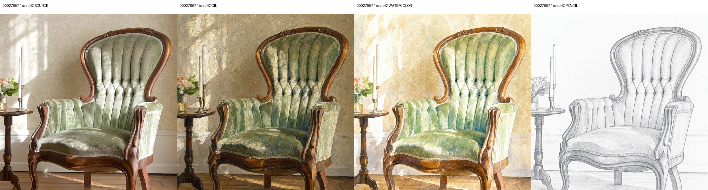
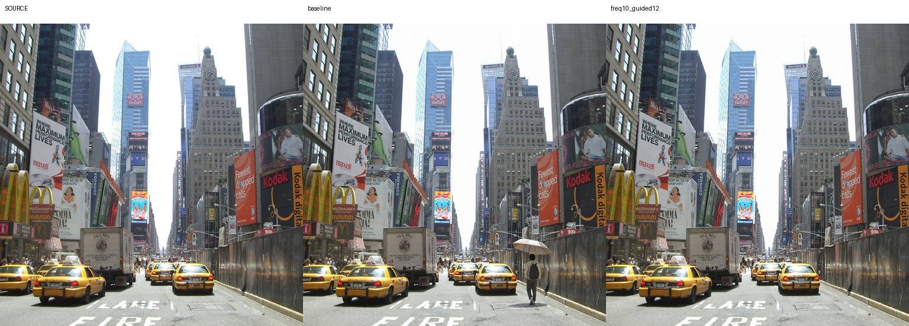
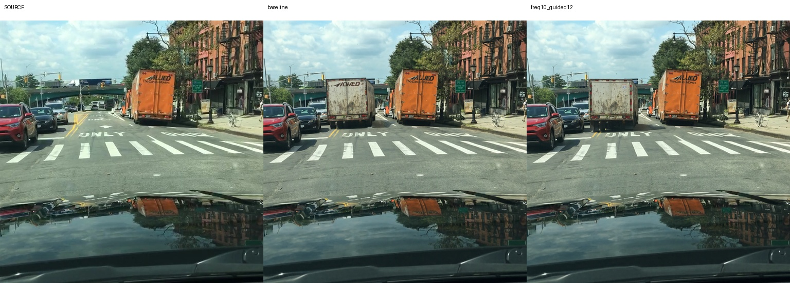

# 精选实验图片

选取三个样例展示任务、可修复错误和持续存在的错误。图片为已有实验输出，未为展示重新生成。完整数据集保存在研究备份中。

## 艺术编辑示例

从左到右为原图、原模型油画、水彩和素描输出，来源编号000278574，seed42。本图说明原模型的风格编辑任务与效果。

## 行人／伞新增的修复案例

从左到右为原图、原模型输出、频率干预结果。原模型在道路右侧增加了行人和伞，候选输出消除了该新增对象。来源00224，seed123。

## 货车新增仍然存在

从左到右为原图、原模型输出、频率干预结果。两种输出都在原图之外增加了一辆浅色货车。来源00640，seed42。

## 两个恒等编辑案例的配置

提示词为 `Reproduce the provided image without any changes. Preserve all objects, geometry, colors, and the entire frame.`

候选采用40步、CFG1.2、alpha1、db4两级小波及前12步频率修正与补偿。原模型输出来自既有恒等编辑baseline。所示方法属于采样阶段干预，静态模型权重保持原值。两个预选案例用于诊断，不能据此估算总体修复率。

## 来源和范围

本页按项目持有者的明确指示选取少量图片用于项目展示。艺术示例来自实验中的ImgEdit输入，街景示例来自所提供的街景输入。来源图的权利仍归原权利人，本项目不对这些图片授予额外数据集再分发许可。文件对应与校验值见 assets/examples/manifest.json。
